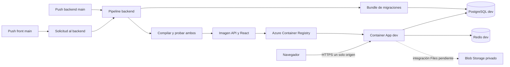

# Azure dev: aprender y configurar el despliegue

Estado al 2026-11-26: el ambiente existe. Lo creó [`provision-azure.sh`](provision-azure.sh) en Central US, con el gasto aprobado por el titular ese día (etapa 2), y `deploy.yml` lo publica con `DEV_DEPLOY_ENABLED=true`. Los dos repositorios son públicos.

## Qué estamos armando

Un ambiente de pruebas real, separado de la computadora: una web con React y la API .NET en una sola Container App. PostgreSQL guarda datos; Redis comparte caché y coordinación; Blob Storage guardará los archivos cuando implementemos el área Files.

El desarrollo local con Aspire continúa igual. Azure no ejecuta AppHost ni el servidor Vite. Vite convierte React en HTML, CSS y JavaScript; la API sirve esos archivos desde wwwroot.



## Palabras que vas a encontrar

| Término | Qué significa acá |
|---|---|
| Pipeline / workflow | Receta automática escrita en YAML. GitHub Actions la ejecuta al recibir un push o una solicitud manual. |
| Runner | Computadora temporal de GitHub, con Ubuntu y Docker. Desaparece al terminar. |
| Job / step | Un trabajo y sus pasos. Build prepara el paquete; deploy lo publica si los controles pasaron. |
| CI | Compilación y pruebas automáticas. Puede funcionar antes de crear Azure. |
| CD | Publicación automática de un paquete verificado. Se habilita después de configurar Azure. |
| Imagen de contenedor | Paquete ejecutable con la API, React compilado y el runtime .NET. Se identifica con una etiqueta única por corrida/intento. |
| Artifact | Archivo que GitHub conserva entre jobs: imagen, bundle y manifest con los dos commits. No es Blob Storage del producto. |
| Registry / ACR | Depósito de imágenes de la aplicación. Azure descarga de acá la imagen que va a ejecutar. |
| Container App / revisión | Servicio que ejecuta el contenedor / una versión de su configuración e imagen. |
| GitHub environment dev | Agrupa configuración y restricciones del despliegue. No crea infraestructura. |
| Variable / secret | Configuración visible / valor sensible que GitHub o Azure protegen. No se pegan en código ni en el chat. |
| OIDC / identidad administrada | Identidad temporal de GitHub para publicar / identidad propia de Azure para leer imágenes y, más adelante, blobs. Son identidades distintas. |
| Bundle EF | Ejecutable que actualiza el esquema de PostgreSQL antes de instalar el código nuevo. No borra la base en cada push. |

El SDK de .NET genera la imagen sin Dockerfile y permite guardarla en un archivo para transferirla entre jobs. [Referencia oficial de contenedores .NET](https://learn.microsoft.com/en-us/dotnet/core/containers/publish-configuration).

## Árbol de archivos de operación

```text
ArquitecturaBase/
├── .github/workflows/
│   ├── deploy.yml                 # Construye ambos proyectos y publica Azure dev
│   ├── AGENTS.md                  # Reglas de mantenimiento del despliegue
│   └── CLAUDE.md
├── docs/deploy/
│   ├── azure-dev.md               # Esta guía: conceptos y puesta en marcha
│   └── azure-setup.md             # Receta técnica de recursos y certificados
├── docs/guides/
│   ├── despliegue.md              # Contrato del arranque y configuración obligatoria
│   └── azure-blob-en-local.md      # Probar Azure Blob desde la computadora
├── src/ArquitecturaBase.Api/
│   └── wwwroot/                   # Generado; no se versiona
└── .artifacts/                    # Generado; no se versiona
    ├── publish/wwwroot/           # React dentro del publicado .NET
    └── deploy/
        ├── image.tar.gz           # Imagen antes de subirla al registry
        ├── efbundle               # Migraciones
        └── manifest.json          # Commits backend/front y etiqueta de imagen

ArquitecturaBaseFront/
└── .github/workflows/
    ├── deploy-dev.yml             # Solicita la pipeline conjunta del backend
    ├── AGENTS.md
    └── CLAUDE.md
```

Estos archivos preparan el despliegue. El árbol de código de almacenamiento sigue en el [plan de archivos](../plans/2026-10-02-almacenamiento-de-archivos.md); no se implementó el upload como parte de esta tarea.

## Etapa 1: verificar sin publicar

El workflow del backend puede compilar y probar sin credenciales de Azure. Si DEV_DEPLOY_ENABLED falta o vale false, deploy se omite. No hace falta crear el environment para correr build.

Build descarga el commit del backend que inició la corrida y main del front. Ejecuta lint, tests y build de React, copia todo dist a wwwroot, compila y prueba .NET con PostgreSQL/Redis de Testcontainers, genera la imagen y el bundle y compara cada archivo del front publicado por SHA-256. El manifest identifica los dos commits realmente usados.

La pipeline debe llegar a GitHub para ejecutarse: los cambios locales no aparecen en Actions. Primero se revisan y se suben ambos workflows; esta preparación no hace commit ni push por cuenta del titular.

## Etapa 2: elegir y crear los recursos

**Decisión del 2026-11-26.** El titular aprobó el ambiente pago, siempre prendido, en la región más barata de las comparadas: allí PostgreSQL cuesta la mitad que en Brazil South y hay unos 150 ms desde Argentina. Eligió East US 2, pero para esta suscripción no tiene B1ms (`SkuNotAvailable`, aunque `list-skus` lo ofrece) y East US tiene restringida la creación de PostgreSQL. Por eso quedó todo en **Central US**, con las mismas tarifas: la Api y la base en la misma región, sin sumarle unos 25 ms a cada consulta. El registry quedó en Brazil South, la región del grupo, y sólo cambia dónde se descargan las imágenes. Un intento fallido deja el nombre del servidor ocupado en esa región por un tiempo; por eso la base se llama `psql-arqbase-dev-cus-…`. Son unos USD 35 a 60 por mes según el uso (la Api activa o en reposo); hasta el 2026-12-17 PostgreSQL B1ms entra en los servicios gratuitos de la suscripción. La [comparación de costos](azure-dev-costos.md) conserva el detalle de las tarifas. La restricción anterior, un ambiente gratuito, queda sin efecto.

Todo sale de un script que se puede volver a correr sin regenerar nada de lo que ya existe. Es el mismo que crea la
instalación de cada cliente ([producción por cliente](produccion-por-cliente.md)); para dev, `INSTALLATION=dev`:

```bash
INSTALLATION=dev LOCATION=centralus PG=psql-arqbase-dev-cus-689638 ACA_ENV=cae-arquitecturabase-dev-cus \
AZURE_SUBSCRIPTION_ID=<id> GITHUB_REPOSITORY=ezeellena2/ArquitecturaBase ALERT_EMAIL=<correo del titular> \
SMTP_USERNAME=... SMTP_PASSWORD=... SMTP_FROM_ADDRESS=... \
SEED_ADMIN_EMAIL=... GOOGLE_CLIENT_ID=... GOOGLE_CLIENT_SECRET=... \
WHATSAPP_PHONE_NUMBER_ID=... WHATSAPP_ACCESS_TOKEN=... WHATSAPP_APP_SECRET=... WHATSAPP_VERIFY_TOKEN=... \
WHATSAPP_WABA_ID=... WHATSAPP_DISPLAY_PHONE_NUMBER=... WHATSAPP_SEND_ARGENTINE_MOBILES_WITHOUT_NINE=true \
bash docs/deploy/provision-azure.sh
```

Corre en Cloud Shell o en Git Bash con Azure CLI y `az login`. Los valores del titular (SMTP, administrador inicial y Google) son los mismos de los user-secrets de la Api, y se pasan como variables sin escribirlos en archivos. El resto de los secretos los genera el script dentro de Azure. Si el grupo ya existe, se reusa aunque esté en otra región: el de dev existía en Brazil South con la cuenta de Storage que usa el desarrollo local (`starqbaseezedev`), que el ambiente no comparte, porque su limpieza de huérfanos borraría los archivos locales.

| Recurso | Responsabilidad | Configuración inicial a resolver |
|---|---|---|
| Resource Group | Agrupa los recursos del ambiente | `rg-arquitecturabase-dev`. |
| Container Registry | Guarda imágenes, también la de Redis | Basic, sin usuario administrador; las apps leen con su identidad (AcrPull). |
| Container Apps Environment | Entorno de ejecución y red | `cae-arquitecturabase-dev-cus`, plan de consumo, logs a Log Analytics. |
| Container App | API y React | `ca-arquitecturabase-dev`: ingress HTTPS externo al 8080, revisiones Single, una réplica de 0,5 vCPU y 1 GiB (la Api arranca con unos 170 MB), probes y apagado de 60 s. |
| Redis | Caché obligatorio y coordinación | `ca-redis-dev`: Redis 8.6 en otra Container App, con ingress TCP interno (sin puerto en Internet), contraseña, 256 MB y `noeviction`, sin persistencia. Es el mismo servidor que en local y lo comparten todas las revisiones de la Api. |
| PostgreSQL Flexible Server | Base appdb | B1ms, 32 GB, versión 18, respaldos de 7 días, TLS y regla para servicios de Azure. |
| Storage Account GPv2 | Archivos privados | `files-content` privado, sin claves compartidas, con borrado temporal, versiones y restauración; la Api entra con su identidad. |
| Identidad de GitHub | Publicar sin contraseña | `id-github-arquitecturabase-dev`, identidad administrada con credencial federada del environment dev, Contributor del grupo y AcrPush. |

Los nombres del registry, la base y el Storage llevan un sufijo derivado de la suscripción, porque son únicos en Azure. La [receta técnica](azure-setup.md) explica cada pieza y sus porqués. Un registry, una base, Redis y los logs generan cargos aunque no visites la web. Con `ALERT_EMAIL`, el script crea un presupuesto mensual del grupo (USD 70; avisa al 80 % del gasto real y al 100 % del pronosticado) y una alerta de errores 5xx de la Api; una alerta avisa, no corta el consumo.

Para consultar Azure desde Windows:
```powershell
az login
az account set --subscription 59608b9d-bdb8-466a-a5a3-149fe20a8e2b
az account show --query "{subscription:id,name:name,tenant:tenantId}" --output table
```

La sesión es interactiva: el titular inicia sesión en su navegador. Los identificadores de suscripción/tenant son configuración; las claves y contraseñas se cargan en sus gestores de secretos.

## Etapa 3: configurar la aplicación en Azure

IA incorpora un requisito nuevo del host: InstallationId, ActiveKeyId y claves del anillo
externo mediante `ArtificialIntelligence__SecretProtection__*`, iguales en las réplicas.
Las claves se referencian desde el gestor de secretos, nunca desde el YAML o la imagen.
La [guía de IA](../guides/configurar-ia.md) fija configuración, backups y rotación; no hace
falta una clave de proveedor para arrancar. El workflow no crea ese anillo. Configurarlo y
probar Azure son pasos pendientes del primer despliegue.

En Container App, los secrets guardan conexiones/contraseñas/PFX; las variables de entorno los referencian. .NET interpreta doble guion bajo como sección: ConnectionStrings__appdb equivale a ConnectionStrings:appdb.

El script carga esta tabla. Genera dentro de Azure, sin mostrarlos, la contraseña de PostgreSQL y la de Redis, la HashKey, los tres PFX con su contraseña y los anillos de IA y ARCA, cada uno con un ID propio de esta instalación. Quedan como secretos de la Container App (`db-connection`, `redis-connection`, `login-code-hash-key`, `signing-pfx`, `encryption-pfx`, `dataprotection-pfx`, `pfx-password`, `ai-installation-id`, `ai-key-v1`, `arca-installation-id`, `arca-key-v1`, `smtp-password` y `google-client-secret`). Una segunda corrida sólo agrega los que faltan: regenerar un PFX o un anillo cerraría las sesiones y dejaría ilegible lo cifrado. El respaldo es `az containerapp secret show`, guardado aparte de la base. Antes de cargar la tabla, la imagen se probó en Production contra una base y un Redis locales: arranca, `/health` da Healthy y .NET acepta los PFX de openssl.

El ambiente del producto se llama dev, pero ASPNETCORE_ENVIRONMENT=Production selecciona el comportamiento del host desplegado: certificados persistentes, sin migraciones automáticas ni secretos locales. Esa palabra no convierte los datos de prueba en producción.

Con ORIGIN=https://<fqdn-de-la-container-app>:

| Variable de la Container App | Valor o lugar del secreto |
|---|---|
| ASPNETCORE_ENVIRONMENT | Production |
| ASPNETCORE_HTTP_PORTS | 8080 |
| ConnectionStrings__appdb | secretref a la conexión PostgreSQL dev, con TLS |
| ConnectionStrings__cache | secretref a Redis; conexión adecuada a su TLS/red |
| Caching__KeyPrefix | arquitecturabase:dev (igual en todas las réplicas) |
| Authentication__Issuer | ORIGIN |
| Authentication__Clients__Web__RedirectUris__0 | ORIGIN/auth/callback |
| Authentication__Clients__Web__RedirectUris__1 | ORIGIN/silent-renew.html |
| Authentication__Clients__Web__PostLogoutRedirectUris__0 | ORIGIN/login |
| Authentication__LoginCode__HashKey | secretref a al menos 32 bytes aleatorios, en base64 |
| Authentication__Certificates__Signing__Base64 y __Password | secretref al PFX de firma y su contraseña |
| Authentication__Certificates__Encryption__Base64 y __Password | secretref al PFX de cifrado y su contraseña |
| Authentication__Certificates__DataProtection__Base64 y __Password | secretref a un PFX con clave privada y contraseña, respaldados aparte de PostgreSQL |
| Authentication__Google__ClientId | Vacío si empezamos sin Google; si lo habilitamos, ClientId y ClientSecret propios del ambiente |
| Email__Delivery | Smtp, para probar correos reales de acceso |
| Email__Smtp__Host, __Port, __UserName, __FromAddress, __Security | Configuración del proveedor SMTP elegido |
| Email__Smtp__Password | secretref a contraseña del proveedor |
| Seed__AdminEmail | Correo del titular que creará su cuenta Admin |
| ForwardedHeaders__TrustAll | true con acceso a Kestrel solo por ingress de Container Apps |
| AllowedHosts | no se define: queda en `*`, porque el ingress ya filtra por host ([por qué](../guides/despliegue.md#proxy-y-encabezados-reenviados)) |

Los nombres exactos de SMTP se contrastan con la [tabla canónica](../guides/despliegue.md#configuración-obligatoria-en-production) y appsettings.json. WhatsApp se prende con las variables `WHATSAPP_*` del script, y el webhook de Meta se carga después ([comprobaciones](#comprobaciones-todavía-externas)). Los PFX son certificados de tokens, distintos del HTTPS que ofrece Azure.

La identidad de la Container App recibe AcrPull sobre el registry. GitHub recibe permisos de despliegue distintos: subir imágenes, actualizar la app y abrir/cerrar el firewall de PostgreSQL. Contributor sobre el grupo dev simplifica el arranque; declarar además AcrPush sobre el registry hace explícito el permiso de publicar imágenes y permite acotar Contributor más adelante. Esta receta usa el modo RBAC clásico, sin ABAC; los roles de repositorio para ABAC son distintos. [Roles de ACR](https://learn.microsoft.com/en-us/azure/container-registry/container-registry-rbac-built-in-roles-overview).

Configurar los probes de la [receta](azure-setup.md#probes): Startup y Liveness en /alive, Readiness en /health, y el plazo de apagado de 60 s. El workflow no despliega sin los probes: sin readiness, Azure asignaría tráfico a una revisión sin base o sin Redis antes de la comprobación final. Un smoke test no reemplaza una prueba de ingreso en el navegador.

## Etapa 4: conectar GitHub con Azure

En el backend, Settings → Environments → New environment → dev. Restringir deployment branches a main. Para dev automático no agregamos revisores obligatorios.

El script crea una identidad administrada en el grupo (`id-github-arquitecturabase-dev`) con una credencial federada: issuer https://token.actions.githubusercontent.com, audience api://AzureADTokenExchange y el subject del environment dev. Vive y se borra con el grupo, sin una App Registration en Entra ID. Solo deploy se autentica, por eso se necesita una credencial de dev, no otra para build.

**Atención al formato del subject:** GitHub cambió el formato por defecto para repositorios creados después del 2026-07-15. Este backend fue creado el 2026-09-18; con esa política por defecto corresponde:
```text
repo:ezeellena2@128924334/ArquitecturaBase@1376411164:environment:dev
```
Si el repositorio personalizó su política OIDC, usar el subject que realmente emite. La [referencia oficial](https://docs.github.com/en/actions/reference/security/oidc#immutable-subject-claims) distingue el formato con IDs del anterior sin IDs. No copiar el ejemplo viejo de production ni dar acceso a todos los repositorios. [Configuración OIDC con Azure](https://docs.github.com/en/actions/how-tos/secure-your-work/security-harden-deployments/oidc-in-azure).

En Settings → Environments → dev, cargar:

| Tipo | Nombre | Valor |
|---|---|---|
| Variable | AZURE_CLIENT_ID | Application/client ID de la App Registration |
| Variable | AZURE_TENANT_ID | Directory/tenant ID de la suscripción |
| Variable | AZURE_SUBSCRIPTION_ID | 59608b9d-bdb8-466a-a5a3-149fe20a8e2b |
| Variable | AZURE_RESOURCE_GROUP | Nombre real del grupo dev |
| Variable | AZURE_REGISTRY | Nombre ACR sin .azurecr.io |
| Variable | AZURE_CONTAINER_APP | Nombre de la Container App |
| Variable | AZURE_POSTGRES_SERVER | Nombre del servidor sin .postgres.database.azure.com |

Con `GITHUB_REPOSITORY` y `gh` autenticado, el script crea el environment, lo limita a main y carga estas variables. No hay secretos de GitHub: el bundle de migraciones lee la conexión del secreto `db-connection` de la Container App, la misma que usa la Api, con la identidad de OIDC.

En Settings → Secrets and variables → Actions del **repositorio backend**, crear la variable DEV_DEPLOY_ENABLED=false inicialmente. Debe ser variable de repositorio, porque se evalúa antes de entrar al environment.

Ambos repos son públicos: no necesitamos FRONTEND_READ_TOKEN. Si se hacen privados, ese secret va a nivel repositorio backend, con Contents: read limitado al front; build lo necesita antes del environment.

## Etapa 5: permitir que un push del front solicite la publicación

El token automático de GitHub está limitado a su propio repositorio. Aunque el backend sea público, iniciar su workflow es una escritura y necesita autorización específica.

En la cuenta GitHub: Settings → Developer settings → Personal access tokens → Fine-grained tokens. Crear uno con caducidad, acceso solo a ArquitecturaBase y permiso Actions: Read and write. Metadata: Read lo incluye GitHub. Copiarlo directamente al secret BACKEND_WORKFLOW_TOKEN del repositorio front. No pegarlo en chat ni archivos.

En el front crear también la variable de repositorio DEV_DEPLOY_ENABLED=false. Al activarla, el workflow del front pide deploy.yml del backend en main. El resultado real se sigue en Actions del backend; la solicitud puede terminar bien y el despliegue fallar. [Permisos para workflow dispatch](https://docs.github.com/en/rest/actions/workflows#create-a-workflow-dispatch-event).

Este PAT entre repositorios no es una contraseña de Azure; OIDC sigue resolviendo Azure sin una clave permanente. Más adelante se puede reemplazar el PAT por una GitHub App.

## Etapa 6: primera publicación y activación

1. Verificar recursos, red, certificados y configuración de la aplicación.
2. Tener ambos workflows en main de GitHub. Ejecutar build con deploy deshabilitado y revisar el paquete y su manifest.
3. Activar DEV_DEPLOY_ENABLED=true en el backend y ejecutar Actions → Verificar y desplegar Azure dev → Run workflow → main.
4. Seguir los pasos: probes → subir imagen → acceso temporal PostgreSQL → migraciones → cierre de acceso → revisión nueva → espera → comprobación pública.
5. Abrir la URL, crear la cuenta del correo Seed__AdminEmail y probar ingreso, roles, sesión, actualización y un reinicio.
6. Activar DEV_DEPLOY_ENABLED=true en el front. Desde ahí, pushes exitosos de cualquiera de los dos repos actualizan dev.

No usar la variable para resetear datos: no existe ese comportamiento. Si se necesita empezar de cero, se programa un reset explícito de dev, con la app detenida y la base correcta identificada.

Si llegan muchos pushes, GitHub ejecuta uno y conserva el último pendiente; no promete publicar todos los commits intermedios. Además, un paquete cuyo commit de cualquiera de los repos fue superado se omite antes de tocar Azure. Un push durante un despliegue ya iniciado puede completar después de ese despliegue; el siguiente instala la versión más reciente.

## Cómo leer una falla

| Último paso | Qué revisar |
|---|---|
| Checkout / npm ci | Repos públicos/acceso; package-lock; versiones de Node. |
| Lint / test / build | Código y dependencias. Azure todavía no recibió cambios. |
| Azure login | IDs, permisos y subject exacto de OIDC/environment. |
| Probes | Falta Startup o Liveness en /alive, o Readiness en /health, en la Container App ([receta](azure-setup.md#probes)). Azure todavía no recibió cambios. |
| Subir imagen | AcrPush para GitHub, modo RBAC y nombre de ACR. |
| Migraciones | Conexión, TLS, firewall y migración. La nueva imagen aún no se activó. |
| Crear/esperar revisión | AcrPull de la app, variables, certificados, Redis y logs de arranque. |
| Comprobación pública | /health, ingreso HTTPS, issuer y presencia de React/silent-renew. |

Una falla después de migrar no deshace el esquema; una falla del smoke tampoco revierte por sí sola la revisión. En dev inspeccionamos el estado y corregimos. Single mantiene la revisión anterior hasta que la nueva cumple readiness, pero exige probes bien configurados y no resuelve compatibilidad de migraciones. [Revisiones de Container Apps](https://learn.microsoft.com/en-us/azure/container-apps/revisions).

Para pausar futuros despliegues, DEV_DEPLOY_ENABLED=false en ambos repos. Esto no detiene la aplicación ni elimina cargos. Los recursos viven hasta detenerlos o eliminarlos expresamente.

## Comprobaciones todavía externas

**Primera publicación, 2026-11-26.** La corrida 45922520503 de `deploy.yml` (back cd318660) publicó en
https://ca-arquitecturabase-dev.lemonmushroom-745a5099.centralus.azurecontainerapps.io: OIDC, probes, imagen, migraciones,
revisión sana y comprobación desde Internet en verde. Un shard de vitest se cortó por tiempo
(`MissingFormsPage`, «gives the wait of a 429…») y pasó al repetir sólo los jobs fallidos. Después, `/health` responde
Healthy, la página sale con Brotli e `index.html` con `no-cache`, el issuer es el origen público y el ingreso con Google
entra como el administrador inicial, con Administración visible. Falta probar el código por correo, la renovación de la
sesión y un reinicio.

**Esa misma noche:**
- **El idioma de la cuenta.** La cuenta del administrador nació en inglés. La toma del `Accept-Language` del navegador en
  su primer ingreso, y ese Chrome está en inglés; el idioma general de Configuración sólo cuenta cuando el navegador no
  pide uno de los dos. Se cambió a español desde el menú del usuario y quedó guardado en la cuenta.
- **WhatsApp prendido en Azure**, con el número, el token, el App Secret y la palabra de verificación de los user-secrets
  (variables `WHATSAPP_*` del script). El webhook de la app de Meta pasó del túnel de la PC a
  `https://<origen>/webhooks/whatsapp`, con los mismos campos. El 2026-11-27 el número de prueba recibió un webhook propio
  hacia el túnel de la PC, para depurar en local: mientras Azure dev use ese mismo número, no recibe mensajes. Azure pasa a
  un número propio (un chip) cambiando `WHATSAPP_PHONE_NUMBER_ID`, `WHATSAPP_WABA_ID` y `WHATSAPP_DISPLAY_PHONE_NUMBER`
  ([en local](../guides/whatsapp-en-local.md#el-túnel-para-recibir-los-webhooks)).
- **IA.** Los perfiles calificados (`ArtificialIntelligence:Assistant:*`: texto, documentos y audio) y la clave de Google
  Places se copiaron de los user-secrets a la Container App: sin perfiles, el asistente no anda aunque haya conexión. La
  clave del proveedor no está en los user-secrets: se guarda cifrada en la base de cada instalación, con su anillo, así
  que en Azure dev se carga de nuevo en Configuración › Inteligencia artificial.
- **La publicación desde el front quedó activa (etapa 5).** El PAT fine-grained «ArquitecturaBaseFront publica Azure dev»
  tiene sólo Actions de lectura y escritura sobre el backend y vence el 2027-11-26. Su prueba con `workflow_dispatch`
  pidió la corrida 45928247791 del backend.

Validación local del 2026-10-02: build .NET Release sin advertencias; 2.057 tests backend (incluida integración con Docker); lint, 829 tests y build front; ambos workflows validados con actionlint 1.7.12. Se generó y cargó la imagen linux/amd64, y se compararon los 76 archivos de React por SHA-256 tanto en el publicado como dentro de la imagen. El bundle Linux se generó y arrancó sin appsettings, hasta intentar la conexión ficticia de prueba; no aplicó migraciones a una base real. El wwwroot temporal se retiró después de probar para conservar el desarrollo local con Vite.

- Verificar el código por correo, la renovación y un reinicio contra Azure, y un mensaje de WhatsApp que llegue a la
  bandeja de Azure dev.
- Renovar el PAT del front antes del 2027-11-26.
- Implementar Files y probar permisos/upload/download de Blob desde local y desde la identidad de la Container App.

El build local, actionlint y los tests no sustituyen estas comprobaciones.
