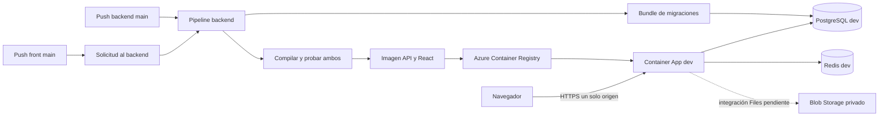

# Azure dev: aprender y configurar el despliegue

Estado al 2026-10-02: workflows preparados en los repositorios locales. No se crearon recursos ni se ejecutó un despliegue en Azure. Los dos repositorios son públicos, confirmado mediante la API de GitHub. La suscripción fue identificada por el titular; región, tamaños y presupuesto quedan por elegir. La CLI local necesita iniciar sesión.

## Qué estamos armando

Un ambiente de pruebas real, separado de la computadora: una web con React y la API .NET en una sola Container App. PostgreSQL guarda datos; Redis comparte caché y coordinación; Blob Storage guardará los archivos cuando implementemos el área Files.

El desarrollo local con Aspire continúa igual. Azure no ejecuta AppHost ni el servidor Vite. Vite convierte React en HTML, CSS y JavaScript; la API sirve esos archivos desde wwwroot.



## Palabras que vas a encontrar

| Término | Qué significa acá |
|---|---|
| Pipeline / workflow | Receta automática escrita en YAML. GitHub Actions la ejecuta al recibir un push o una solicitud manual. |
| Runner | Computadora temporal de GitHub, con Ubuntu y Docker. Desaparece al terminar. |
| Job / step | Un trabajo y sus pasos. Build prepara el paquete; deploy lo publica si los controles pasaron. |
| CI | Compilación y pruebas automáticas. Puede funcionar antes de crear Azure. |
| CD | Publicación automática de un paquete verificado. Se habilita después de configurar Azure. |
| Imagen de contenedor | Paquete ejecutable con la API, React compilado y el runtime .NET. Se identifica con una etiqueta única por corrida/intento. |
| Artifact | Archivo que GitHub conserva entre jobs: imagen, bundle y manifest con los dos commits. No es Blob Storage del producto. |
| Registry / ACR | Depósito de imágenes de la aplicación. Azure descarga de acá la imagen que va a ejecutar. |
| Container App / revisión | Servicio que ejecuta el contenedor / una versión de su configuración e imagen. |
| GitHub environment dev | Agrupa configuración y restricciones del despliegue. No crea infraestructura. |
| Variable / secret | Configuración visible / valor sensible que GitHub o Azure protegen. No se pegan en código ni en el chat. |
| OIDC / identidad administrada | Identidad temporal de GitHub para publicar / identidad propia de Azure para leer imágenes y, más adelante, blobs. Son identidades distintas. |
| Bundle EF | Ejecutable que actualiza el esquema de PostgreSQL antes de instalar el código nuevo. No borra la base en cada push. |

El SDK de .NET genera la imagen sin Dockerfile y permite guardarla en un archivo para transferirla entre jobs. [Referencia oficial de contenedores .NET](https://learn.microsoft.com/en-us/dotnet/core/containers/publish-configuration).

## Árbol de archivos de operación

```text
ArquitecturaBase/
├── .github/workflows/
│   ├── deploy.yml                 # Construye ambos proyectos y publica Azure dev
│   ├── AGENTS.md                  # Reglas de mantenimiento del despliegue
│   └── CLAUDE.md
├── docs/deploy/
│   ├── azure-dev.md               # Esta guía: conceptos y puesta en marcha
│   └── azure-setup.md             # Receta técnica de recursos y certificados
├── docs/guides/
│   ├── despliegue.md              # Contrato del arranque y configuración obligatoria
│   └── azure-blob-en-local.md      # Probar Azure Blob desde la computadora
├── src/ArquitecturaBase.Api/
│   └── wwwroot/                   # Generado; no se versiona
└── .artifacts/                    # Generado; no se versiona
    ├── publish/wwwroot/           # React dentro del publicado .NET
    └── deploy/
        ├── image.tar.gz           # Imagen antes de subirla al registry
        ├── efbundle               # Migraciones
        └── manifest.json          # Commits backend/front y etiqueta de imagen

ArquitecturaBaseFront/
└── .github/workflows/
    ├── deploy-dev.yml             # Solicita la pipeline conjunta del backend
    ├── AGENTS.md
    └── CLAUDE.md
```

Estos archivos preparan el despliegue. El árbol de código de almacenamiento sigue en el [plan de archivos](../plans/2026-10-02-almacenamiento-de-archivos.md); no se implementó el upload como parte de esta tarea.

## Etapa 1: verificar sin publicar

El workflow del backend puede compilar y probar sin credenciales de Azure. Si DEV_DEPLOY_ENABLED falta o vale false, deploy se omite. No hace falta crear el environment para correr build.

Build descarga el commit del backend que inició la corrida y main del front. Ejecuta lint, tests y build de React, copia todo dist a wwwroot, compila y prueba .NET con PostgreSQL/Redis de Testcontainers, genera la imagen y el bundle y compara cada archivo del front publicado por SHA-256. El manifest identifica los dos commits realmente usados.

La pipeline debe llegar a GitHub para ejecutarse: los cambios locales no aparecen en Actions. Primero se revisan y se suben ambos workflows; esta preparación no hace commit ni push por cuenta del titular.

## Etapa 2: elegir y crear los recursos

El titular descartó el gasto de USD 50/mes y pide un ambiente gratuito. La [comparación actualizada](azure-dev-costos.md#restricción-vigente-ambiente-gratuito) conserva el escenario pago como referencia y evalúa App Service F1 y beneficios gratuitos de datos. No crear los recursos pagos de esta receta ni activar el deploy actual. Si elegimos F1, se adapta el destino del workflow conservando las pruebas y el empaquetado de React/API; ese cambio todavía no se implementó.

La región se elige comparando disponibilidad de servicios, latencia y costo. Brazil South es un candidato por cercanía a Argentina; East US es otro candidato para comparar precios. No fijamos una región ni tamaños sin revisar la suscripción. Ver [productos por región](https://azure.microsoft.com/en-us/explore/global-infrastructure/products-by-region/) y [calculadora de Azure](https://azure.microsoft.com/en-us/pricing/calculator/).

Usaremos nombres con dev y un único grupo de recursos, por ejemplo rg-arquitecturabase-dev. ACR, PostgreSQL y Storage requieren nombres disponibles; los ejemplos no garantizan disponibilidad.

| Recurso | Responsabilidad | Configuración inicial a resolver |
|---|---|---|
| Resource Group | Agrupa los recursos del ambiente | Suscripción correcta, región y etiqueta environment=dev. |
| Container Registry | Guarda imágenes | Basic como candidato; administración por credenciales deshabilitada, acceso por identidad. |
| Container Apps Environment | Entorno de ejecución y red | Misma región; decidir red y logs. |
| Container App | API y React | Ingress HTTPS externo, puerto 8080, revisiones Single; una réplica como punto de partida para workers. |
| PostgreSQL Flexible Server | Base appdb | Versión 18 si está disponible en la región; tamaño a cotizar; TLS y firewall. |
| Redis | Caché obligatorio y coordinación | Decidir servicio administrado frente a Redis interno para dev, costo y acceso privado. No publicar el puerto de Redis en Internet. |
| Storage Account GPv2 | Objetos de Files | Contenedores privados, Hot/LRS como candidato para pruebas; integración de la API pendiente. |
| Presupuesto | Ayuda a controlar gastos | Alerta mensual; una alerta no corta el consumo automáticamente. |

La [receta técnica](azure-setup.md) crea Container Apps/ACR/PostgreSQL y muestra certificados. No crea Redis ni Blob ni resuelve toda la red. Antes de usarla completamos esas elecciones; no es todavía un script de infraestructura integral. Un registry, una base, Redis y los logs pueden generar cargos aunque no visites la web.

Para consultar Azure desde Windows:
```powershell
az login
az account set --subscription 59608b9d-bdb8-466a-a5a3-149fe20a8e2b
az account show --query "{subscription:id,name:name,tenant:tenantId}" --output table
```

La sesión es interactiva: el titular inicia sesión en su navegador. Los identificadores de suscripción/tenant son configuración; las claves y contraseñas se cargan en sus gestores de secretos.

## Etapa 3: configurar la aplicación en Azure

IA incorpora un requisito nuevo del host: InstallationId, ActiveKeyId y claves del anillo
externo mediante `ArtificialIntelligence__SecretProtection__*`, iguales en las réplicas.
Las claves se referencian desde el gestor de secretos, nunca desde el YAML o la imagen.
La [guía de IA](../guides/configurar-ia.md) fija configuración, backups y rotación; no hace
falta una clave de proveedor para arrancar. El workflow no crea ese anillo. Configurarlo y
probar Azure son pasos pendientes del primer despliegue.

En Container App, los secrets guardan conexiones/contraseñas/PFX; las variables de entorno los referencian. .NET interpreta doble guion bajo como sección: ConnectionStrings__appdb equivale a ConnectionStrings:appdb.

El ambiente del producto se llama dev, pero ASPNETCORE_ENVIRONMENT=Production selecciona el comportamiento del host desplegado: certificados persistentes, sin migraciones automáticas ni secretos locales. Esa palabra no convierte los datos de prueba en producción.

Con ORIGIN=https://<fqdn-de-la-container-app>:

| Variable de la Container App | Valor o lugar del secreto |
|---|---|
| ASPNETCORE_ENVIRONMENT | Production |
| ASPNETCORE_HTTP_PORTS | 8080 |
| ConnectionStrings__appdb | secretref a la conexión PostgreSQL dev, con TLS |
| ConnectionStrings__cache | secretref a Redis; conexión adecuada a su TLS/red |
| Caching__KeyPrefix | arquitecturabase:dev (igual en todas las réplicas) |
| Authentication__Issuer | ORIGIN |
| Authentication__Clients__Web__RedirectUris__0 | ORIGIN/auth/callback |
| Authentication__Clients__Web__RedirectUris__1 | ORIGIN/silent-renew.html |
| Authentication__Clients__Web__PostLogoutRedirectUris__0 | ORIGIN/login |
| Authentication__LoginCode__HashKey | secretref a al menos 32 bytes aleatorios, en base64 |
| Authentication__Certificates__Signing__Base64 y __Password | secretref al PFX de firma y su contraseña |
| Authentication__Certificates__Encryption__Base64 y __Password | secretref al PFX de cifrado y su contraseña |
| Authentication__Certificates__DataProtection__Base64 y __Password | secretref a un PFX con clave privada y contraseña, respaldados aparte de PostgreSQL |
| Authentication__Google__ClientId | Vacío si empezamos sin Google; si lo habilitamos, ClientId y ClientSecret propios del ambiente |
| Email__Delivery | Smtp, para probar correos reales de acceso |
| Email__Smtp__Host, __Port, __UserName, __FromAddress, __Security | Configuración del proveedor SMTP elegido |
| Email__Smtp__Password | secretref a contraseña del proveedor |
| Seed__AdminEmail | Correo del titular que creará su cuenta Admin |
| ForwardedHeaders__TrustAll | true con acceso a Kestrel solo por ingress de Container Apps |
| AllowedHosts | FQDN público, sin https:// ni ruta |

Los nombres exactos de SMTP se contrastan con la [tabla canónica](../guides/despliegue.md#configuración-obligatoria-en-production) y appsettings.json. WhatsApp queda apagado hasta configurar su cuenta/webhook de dev. Los PFX son certificados de tokens, distintos del HTTPS que ofrece Azure.

La identidad de la Container App recibe AcrPull sobre el registry. GitHub recibe permisos de despliegue distintos: subir imágenes, actualizar la app y abrir/cerrar el firewall de PostgreSQL. Contributor sobre el grupo dev simplifica el arranque; declarar además AcrPush sobre el registry hace explícito el permiso de publicar imágenes y permite acotar Contributor más adelante. Esta receta usa el modo RBAC clásico, sin ABAC; los roles de repositorio para ABAC son distintos. [Roles de ACR](https://learn.microsoft.com/en-us/azure/container-registry/container-registry-rbac-built-in-roles-overview).

Configurar probes: /alive para liveness y /health para readiness, como muestra la [receta](azure-setup.md#probes-opcional). Sin readiness, la comprobación final de la pipeline puede detectar la falla después de que Azure asignó tráfico. Un smoke test no reemplaza una prueba de ingreso en el navegador.

## Etapa 4: conectar GitHub con Azure

En el backend, Settings → Environments → New environment → dev. Restringir deployment branches a main. Para dev automático no agregamos revisores obligatorios.

En Microsoft Entra ID, crear una App Registration y su service principal para GitHub. Agregar una credencial federada con issuer https://token.actions.githubusercontent.com, audience api://AzureADTokenExchange y subject del environment dev. Solo deploy se autentica, por eso se necesita una credencial de dev, no otra para build.

**Atención al formato del subject:** GitHub cambió el formato por defecto para repositorios creados después del 2026-07-15. Este backend fue creado el 2026-09-18; con esa política por defecto corresponde:
```text
repo:ezeellena2@128924334/ArquitecturaBase@1376411164:environment:dev
```
Si el repositorio personalizó su política OIDC, usar el subject que realmente emite. La [referencia oficial](https://docs.github.com/en/actions/reference/security/oidc#immutable-subject-claims) distingue el formato con IDs del anterior sin IDs. No copiar el ejemplo viejo de production ni dar acceso a todos los repositorios. [Configuración OIDC con Azure](https://docs.github.com/en/actions/how-tos/secure-your-work/security-harden-deployments/oidc-in-azure).

En Settings → Environments → dev, cargar:

| Tipo | Nombre | Valor |
|---|---|---|
| Variable | AZURE_CLIENT_ID | Application/client ID de la App Registration |
| Variable | AZURE_TENANT_ID | Directory/tenant ID de la suscripción |
| Variable | AZURE_SUBSCRIPTION_ID | 59608b9d-bdb8-466a-a5a3-149fe20a8e2b |
| Variable | AZURE_RESOURCE_GROUP | Nombre real del grupo dev |
| Variable | AZURE_REGISTRY | Nombre ACR sin .azurecr.io |
| Variable | AZURE_CONTAINER_APP | Nombre de la Container App |
| Variable | AZURE_POSTGRES_SERVER | Nombre del servidor sin .postgres.database.azure.com |
| Secret | DB_CONNECTION_STRING | Conexión a appdb dev utilizada solo por el bundle |

En Settings → Secrets and variables → Actions del **repositorio backend**, crear la variable DEV_DEPLOY_ENABLED=false inicialmente. Debe ser variable de repositorio, porque se evalúa antes de entrar al environment.

Ambos repos son públicos: no necesitamos FRONTEND_READ_TOKEN. Si se hacen privados, ese secret va a nivel repositorio backend, con Contents: read limitado al front; build lo necesita antes del environment.

## Etapa 5: permitir que un push del front solicite la publicación

El token automático de GitHub está limitado a su propio repositorio. Aunque el backend sea público, iniciar su workflow es una escritura y necesita autorización específica.

En la cuenta GitHub: Settings → Developer settings → Personal access tokens → Fine-grained tokens. Crear uno con caducidad, acceso solo a ArquitecturaBase y permiso Actions: Read and write. Metadata: Read lo incluye GitHub. Copiarlo directamente al secret BACKEND_WORKFLOW_TOKEN del repositorio front. No pegarlo en chat ni archivos.

En el front crear también la variable de repositorio DEV_DEPLOY_ENABLED=false. Al activarla, el workflow del front pide deploy.yml del backend en main. El resultado real se sigue en Actions del backend; la solicitud puede terminar bien y el despliegue fallar. [Permisos para workflow dispatch](https://docs.github.com/en/rest/actions/workflows#create-a-workflow-dispatch-event).

Este PAT entre repositorios no es una contraseña de Azure; OIDC sigue resolviendo Azure sin una clave permanente. Más adelante se puede reemplazar el PAT por una GitHub App.

## Etapa 6: primera publicación y activación

1. Verificar recursos, red, certificados y configuración de la aplicación.
2. Tener ambos workflows en main de GitHub. Ejecutar build con deploy deshabilitado y revisar el paquete y su manifest.
3. Activar DEV_DEPLOY_ENABLED=true en el backend y ejecutar Actions → Verificar y desplegar Azure dev → Run workflow → main.
4. Seguir los pasos: subir imagen → acceso temporal PostgreSQL → migraciones → cierre de acceso → revisión nueva → espera → comprobación pública.
5. Abrir la URL, crear la cuenta del correo Seed__AdminEmail y probar ingreso, roles, sesión, actualización y un reinicio.
6. Activar DEV_DEPLOY_ENABLED=true en el front. Desde ahí, pushes exitosos de cualquiera de los dos repos actualizan dev.

No usar la variable para resetear datos: no existe ese comportamiento. Si se necesita empezar de cero, se programa un reset explícito de dev, con la app detenida y la base correcta identificada.

Si llegan muchos pushes, GitHub ejecuta uno y conserva el último pendiente; no promete publicar todos los commits intermedios. Además, un paquete cuyo commit de cualquiera de los repos fue superado se omite antes de tocar Azure. Un push durante un despliegue ya iniciado puede completar después de ese despliegue; el siguiente instala la versión más reciente.

## Cómo leer una falla

| Último paso | Qué revisar |
|---|---|
| Checkout / npm ci | Repos públicos/acceso; package-lock; versiones de Node. |
| Lint / test / build | Código y dependencias. Azure todavía no recibió cambios. |
| Azure login | IDs, permisos y subject exacto de OIDC/environment. |
| Subir imagen | AcrPush para GitHub, modo RBAC y nombre de ACR. |
| Migraciones | Conexión, TLS, firewall y migración. La nueva imagen aún no se activó. |
| Crear/esperar revisión | AcrPull de la app, variables, certificados, Redis y logs de arranque. |
| Comprobación pública | /health, ingreso HTTPS, issuer y presencia de React/silent-renew. |

Una falla después de migrar no deshace el esquema; una falla del smoke tampoco revierte por sí sola la revisión. En dev inspeccionamos el estado y corregimos. Single mantiene la revisión anterior hasta que la nueva cumple readiness, pero exige probes bien configurados y no resuelve compatibilidad de migraciones. [Revisiones de Container Apps](https://learn.microsoft.com/en-us/azure/container-apps/revisions).

Para pausar futuros despliegues, DEV_DEPLOY_ENABLED=false en ambos repos. Esto no detiene la aplicación ni elimina cargos. Los recursos viven hasta detenerlos o eliminarlos expresamente.

## Comprobaciones todavía externas

Validación local del 2026-10-02: build .NET Release sin advertencias; 2.057 tests backend (incluida integración con Docker); lint, 829 tests y build front; ambos workflows validados con actionlint 1.7.12. Se generó y cargó la imagen linux/amd64, y se compararon los 76 archivos de React por SHA-256 tanto en el publicado como dentro de la imagen. El bundle Linux se generó y arrancó sin appsettings, hasta intentar la conexión ficticia de prueba; no aplicó migraciones a una base real. El wwwroot temporal se retiró después de probar para conservar el desarrollo local con Vite.

- Crear recursos y configurar red, identidades y secrets en Azure/GitHub.
- Ejecutar realmente ambos disparadores en Actions y confirmar el paquete publicado.
- Verificar ingreso, renovación y reinicio contra Azure.
- Implementar Files y probar permisos/upload/download de Blob desde local y desde la identidad de la Container App.

El build local, actionlint y los tests no sustituyen estas comprobaciones.
