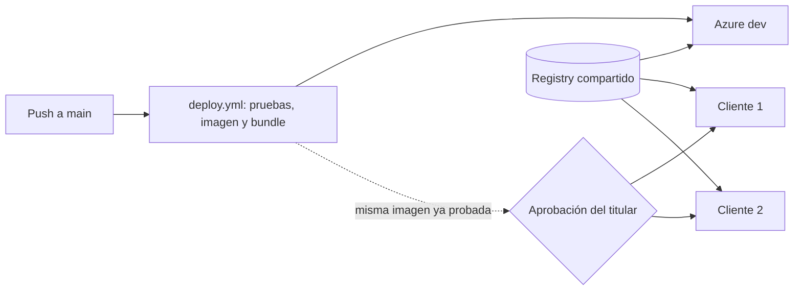

# Producción por cliente: una instalación por empresa

Estado: **T1 a T5 hechas el 2026-11-27: La Clementina es el primer cliente publicado. T6 y T7 (el consumo en el backend) programadas el mismo día; T8, la pantalla, en curso.** La receta para usarlo está en [producción por cliente](../deploy/produccion-por-cliente.md). El titular ya tiene clientes y decidió que, mientras el multitenant
no esté terminado, cada empresa que lo contrata tenga su propia instalación en Azure. Cuando el multitenant esté listo, los
clientes pasan a él con un plan aparte. [Azure dev](../deploy/azure-dev.md) sigue siendo el ambiente para probar y romper,
con el número de prueba de WhatsApp.

## Cómo queda

Cada cliente es una instalación completa y aislada, igual a la de dev: su grupo de recursos, su entorno de Container Apps
con la Api y Redis, su PostgreSQL, su Storage, sus anillos de claves con `InstallationId` propio, su origen público y su
número de WhatsApp. No comparten base, caché, archivos ni claves. Borrar el grupo de un cliente lo da de baja entero.

## Decisiones

Lo que el plan fija, con la opción más simple que cumple las reglas del proyecto:

| # | Decisión | Por qué |
|---|---|---|
| PR1 | Un grupo `rg-arquitecturabase-<cliente>` por empresa, con su entorno, su Api, su Redis, su PostgreSQL B1ms y su Storage. `<cliente>` es un nombre corto en minúsculas | Aislamiento completo; el costo y la baja quedan por cliente |
| PR2 | Un solo registry, el de dev, para todos | Es la misma imagen; cada instalación la lee con su identidad (AcrPull sobre ese registry) |
| PR3 | Producción recibe **la imagen y el bundle que ya pasaron por dev**, sin volver a compilar | Lo que se publica en un cliente es exactamente lo que se probó |
| PR4 | Promoción manual: `deploy-production.yml` se corre a mano, eligiendo el cliente y la corrida verde de dev, y espera la aprobación del titular en el environment `prod-<cliente>` | Un push publica sólo en dev; un cliente cambia cuando el titular decide |
| PR5 | El paquete de dev se guarda 30 días, no 3 | Para poder promover una versión probada unos días antes |
| PR6 | Un subdominio por cliente (`<cliente>.<dominio-del-titular>`) con certificado administrado de Container Apps, gratis. Hasta tener el dominio, el FQDN de Azure | Una sola compra de dominio; el cliente puede apuntar después su propio dominio |
| PR7 | Una réplica por instalación | La limpieza de archivos todavía no tiene lease para varias réplicas (N28) |
| PR8 | Respaldos de PostgreSQL de 14 días en producción (7 en dev) | Más margen para restaurar un error de un cliente |
| PR9 | Una alerta de presupuesto y una de errores 5xx por grupo, al correo del titular | Una alerta avisa, no corta el consumo; cada cliente se ve por separado |

**Resueltas por el titular el 2026-11-27, con lo recomendado:**
- **PR10. De quién es la cuenta de WhatsApp de cada cliente.** Para los primeros, el número del cliente queda en el
  portfolio del titular: misma app de Meta y un webhook propio por número hacia su instalación, como el de
  prueba hacia la PC; `publish-azure.yml` se lo pone al publicar. Para cuando sean más, es registrarse como proveedor de tecnología (Embedded Signup):
  cada empresa conecta su propia cuenta, con su verificación y su medio de pago.
- **PR11. Con qué cuenta salen los correos.** Por defecto, la de Gmail del titular, con su cupo de unos 500 por día
  repartido con `EMAIL_DAILY_LIMIT` entre las instalaciones que la usan. Una cuenta por cliente o un proveedor
  transaccional, cuando el cupo no alcance.

**Consumo por instalación (2026-11-27).** Para calcular el costo mensual de cada cliente, el titular pidió ver en su
instalación el consumo de IA y de WhatsApp. Eligió el tablero **CO1-B** del lienzo
[Consumo de IA y WhatsApp](https://claude.ai/artifact/JgHE2i54i9wFsGtcenGH1o): Configuración › Consumo, con el mes en la
dirección, un resumen arriba (IA, WhatsApp y el total si las dos van en dólares) y una zona por módulo.

| # | Decisión | Por qué |
|---|---|---|
| PR12 | La IA suma por mes y modelo los turnos que llegaron al proveedor (`ProviderSteps > 0`): pedidos, tokens de entrada y de salida, segundos de audio y los de uso desconocido. Antes de que la retención borre una conversación, sus turnos se suman a `AiUsageMonths` en la misma unidad | La retención borra los turnos a los 30 días como mucho; sin el resumen, los meses anteriores quedarían en cero |
| PR13 | El costo de la IA es una estimación con precios por modelo que carga el administrador (USD por millón de tokens de entrada y de salida, y por minuto de audio), con revisión y 409. Sin precio, el modelo no suma y la pantalla lo dice | No hay precios en el código ([reglas en Configuración](2026-11-22-reglas-a-configuracion.md)); la API de costos de OpenAI pide una clave de administrador de la organización |
| PR14 | WhatsApp muestra lo que informa Meta (`pricing_analytics` de la WABA filtrado por el número de la instalación): mensajes entregados y costo por categoría, en la moneda de la cuenta. Se lee al abrir la pantalla, sin caché ni estado guardado; si Meta no responde, la zona lo dice y ofrece reintentar | Es la fuente del cobro; leer un dato externo para mostrarlo no necesita recuperación durable ([ADR 0018](../decisions/0018-robustez-proporcional-al-efecto.md)) |
| PR15 | Sin permisos nuevos: la zona de IA pide `ai.read` y sus precios `ai.manage`; la de WhatsApp, `settings.manage`, como su configuración | Son datos de la configuración de cada módulo, para quien ya la administra |
| PR16 | El mes es el del negocio, en la zona horaria de la Configuración general (`BusinessMonth`), como los cupos diarios | Un mes que empieza a la medianoche del negocio, no a la de UTC |

## Tareas

| # | Qué | Dónde |
|---|---|---|
| T1 | El script acepta `ACR_RESOURCE_GROUP` (registry compartido), `CUSTOM_DOMAIN` (origen público y certificado), `GITHUB_ENVIRONMENT` (`dev` por defecto; `prod-<cliente>` con el titular como revisor obligatorio), los días de respaldo, y crea las dos alertas | `docs/deploy/provision-azure.sh` |
| T2 | El job que publica pasa a un workflow reutilizable (`workflow_call`), con el environment y la corrida del paquete como entradas. `deploy.yml` lo llama para dev; `deploy-production.yml` (`workflow_dispatch`) lo llama para un cliente con el paquete de una corrida verde de dev | `.github/workflows/` |
| T3 | El paquete de dev se guarda 30 días | `deploy.yml` |
| T4 | Guía de alta, actualización y baja de un cliente, con los registros DNS, el número de WhatsApp y la primera promoción | `docs/deploy/produccion-por-cliente.md`, y las referencias en `azure-dev.md`, `azure-setup.md` y el `AGENTS.md` de workflows |
| T5 | El primer cliente: script, DNS, WhatsApp, promoción, `/health` e ingreso del administrador | Azure y GitHub |
| T6 | Consumo de IA: `AiUsageMonth` y su suma en la retención, `AiModelPrice`, `GET api/ai/usage?month=` y `PUT api/ai/usage/prices` | Módulo de IA (Domain, Application, Infrastructure, Api) y sus pruebas |
| T7 | Consumo de WhatsApp: lectura de `pricing_analytics` y `GET api/whatsapp/usage?month=` | Módulo de WhatsApp y sus pruebas |
| T8 | Pantalla Consumo igual al tablero CO1-B: resumen, zona de IA con el diálogo de precios, zona de WhatsApp y los estados del tablero «Estados» | `ArquitecturaBaseFront`, registrado en `docs/design` |

T1 a T4 se programan juntas: sin T2 no hay cómo publicar en un cliente, y sin T1 no hay cliente. T5 va cuando el titular
tenga los datos del primero. T6 a T8 van en paralelo, con los contratos fijados en este plan.

## Lo que hace el titular por cada cliente

1. El nombre corto, el subdominio y los dos registros DNS (CNAME y el TXT `asuid`) en el proveedor del dominio.
2. El correo del administrador del cliente, que va en `SEED_ADMIN_EMAIL`.
3. El número de WhatsApp: registrarlo con el código que llega por SMS o llamada, el nombre visible, las plantillas
   aprobadas y el medio de pago (según PR10).
4. Aprobar el gasto (unos USD 35 a 60 por mes por cliente, más los mensajes de WhatsApp) y cada promoción en GitHub.

## Fuera de este plan

- Pasar los clientes al multitenant, con sus datos: plan aparte cuando el multitenant esté listo.
- Compartir un servidor de PostgreSQL entre clientes para bajar el costo: se decide si el costo lo pide.
- Red privada para la base y Key Vault: siguen en [verificación y producción](verificacion-y-produccion.md#despliegue-y-operación).

## Marca por empresa (ME)

Estado: **el titular eligió ME1-A y ME3-B el 2026-11-27. T9 a T12 están en `main` (back y front) con sus tests en verde,
y la documentación de T13 también.** Faltan:
- el logo en el encabezado del PDF de una respuesta (módulo de Formularios);
- borrar la columna `EmailLogoUrl` en el despliegue siguiente, con una migración escrita a mano (la de T9 la dejó porque la
  imagen anterior la lee mientras corre el bundle);
- publicar en dev y en La Clementina (push y «Publicar en un cliente», con el visto bueno del titular), cargar ahí su marca
  y probarla a mano.

Las escenas visuales de siempre no traen marca (la banda queda vacía, como antes) para no rehacer las ~500 capturas; las
escenas `brand-…` muestran un logo, un acento y una letra genéricos.
Lienzo:
[Marca por empresa](https://claude.ai/artifact/YKWuNW5xwL4EfSgstiMWrn).

El titular quiere que cada empresa vea el producto con su logo, sus colores y su letra. Preguntó si convenía una rama
por empresa y eligió un solo código: lo de todos va a `main` y lo de cada empresa son datos de su instalación, que
carga su administrador en Configuración › Apariencia. Así se sigue publicando la misma imagen probada en dev (PR3) y los
clientes pueden pasar al multitenant. Lo que sólo sirve a una empresa se convierte primero en una capacidad genérica
([dinamismo para el campo](2026-11-19-procesos-del-campo.md)); si no se puede, va en un repo aparte que usa la API de su
instalación, nunca en una copia de este.

Hoy cada instalación ya guarda cuatro colores, el nombre de la aplicación, el remitente y la dirección de un logo para
los correos ([Apariencia](../features/administracion.md#apariencia-global-2026-10-01)). Faltan el logo dentro de la
app, subirlo como archivo, el ícono de la pestaña y la letra. La prueba es La Clementina: su logo y su paleta (azul
pizarra `#2B4150`, crema `#F6F2E9`) cargados en su instalación, sin código propio.

**Elegidas por el titular el 2026-11-27:**

| # | Decisión | Tablero |
|---|---|---|
| ME1-A | El logo va en la banda de arriba del menú, que hoy está vacía, y lleva al inicio. Con el menú contraído va el ícono | ME1-A · El logo arriba del menú |
| ME3-B | Un quinto color, «Acento del menú», reemplaza al acento que hoy el front deriva del color del menú (`--color-nav-accent`: la barra del ítem activo, el foco y el avatar del menú principal) y además pinta el texto del ítem activo, también contraído. Tiene que dar 4,5:1 contra el color del menú, porque pinta texto: el dominio lo valida y el `PATCH` responde 400 en `appearance.menuAccentColor`. La columna admite vacío, que significa «el derivado del menú», como hoy: así ninguna instalación cambia con la migración, y la API siempre responde el color efectivo. «Restaurar los iniciales» lo vuelve a `#D3D7D5` (el de Campo) y la comparación de un conflicto lo incluye | ME3 · ¿Alcanzan los cuatro colores? (columna B) |

Se descartaron ME1-B (el logo en la barra superior) y ME3-A (sólo los cuatro colores).

**Fijadas por el plan**, con la opción más simple que cumple las reglas:

| # | Decisión | Por qué |
|---|---|---|
| ME2 | Logo e ícono son archivos subidos en Apariencia (zona «Marca»), igual al tablero ME2. Logo: PNG o JPG apaisado, hasta 1 MB. Ícono: PNG cuadrado, desde 64 px. Se validan por su contenido, su tamaño y sus medidas en el navegador y en el servidor | Los correos necesitan PNG o JPG (Gmail no muestra SVG); un archivo propio no depende de una dirección ajena |
| ME2b | Se guardan al subirlos y al quitarlos: `POST` (como las demás subidas) y `DELETE` en `api/settings/brand/logo` y `api/settings/brand/icon`, con la revisión leída, lock, transacción y 409, como el `PATCH`. La respuesta trae la revisión nueva y la pantalla conserva el borrador del resto. Quitar pide confirmación | Un archivo no es borrador; mandar el archivo dentro del `PATCH` cambiaría su contrato JSON |
| ME2c | Los bytes van al almacén privado de la instalación (`IPrivateFileStore`) con clave nueva por subida; `SystemSettings` guarda la clave, el tipo y una versión. Una fuente de retención (`IPrivateFileRetentionSource`) los declara usados, y la limpieza de siempre borra los reemplazados | Las mismas reglas que los demás archivos ([almacenamiento](2026-10-02-almacenamiento-de-archivos.md)); sin limpieza nueva |
| ME2d | `GET api/settings/brand/logo` y `…/icon` son anónimos y responden la imagen con `ETag`; pedidos con `?v=<versión>`, se guardan en caché un año | El ingreso, los correos y la pestaña los muestran sin sesión |
| ME2e | El logo subido reemplaza a «Logo de los correos» (`EmailLogoUrl` sale del dominio, del contrato, de la base y de los textos). Los correos lo toman del origen público de la instalación y el PDF lo dibuja donde hoy va el nombre | Un solo logo para todo. El contrato sólo lo usa el front ([ADR 0005](../decisions/0005-sin-versionado-de-api-por-ahora.md) no aplica); antes de la migración se mira que dev y La Clementina no tengan uno cargado |
| ME4 | Una sola letra para toda la app, de una lista cerrada: Public Sans (la inicial), Inter, IBM Plex Sans, Source Sans 3, Hanken Grotesk y Nunito Sans. El front las trae con `@fontsource-variable` y carga sólo la elegida. Los correos y el PDF siguen con la suya | Mismo origen y sin Google Fonts; cinco niveles tipográficos con una familia, como hoy |
| ME5 | La pestaña dice «pantalla · nombre de la aplicación» y usa el ícono; sin ícono, el de siempre | Distinguir la instalación entre pestañas |
| ME6 | Sin logo, la banda del menú dice el nombre de la aplicación en texto; el ingreso, los correos y el PDF, también el nombre. Sin ícono, el menú contraído deja la banda vacía | La marca es el nombre, como dice hoy el fundamento visual |
| ME7 | `GET api/settings/presentation` (anónimo) suma `brand`: nombre, versión del logo y del ícono (o nada) y letra | El ingreso y el caparazón se pintan antes de la sesión, como los colores |
| ME8 | Sin permisos nuevos: todo pide `settings.manage`, como Apariencia | Es la configuración de la instalación |

**Tareas** (cada una cierra con sus tests, el build sin advertencias y la integración de lo que cambió):

| # | Qué | Dónde |
|---|---|---|
| T9 | Logo e ícono: dominio, almacén, fuente de retención, `POST`, `DELETE` y `GET` anónimos, `brand` en la presentación, correos y PDF con el logo, migración que quita `EmailLogoUrl`; con sus pruebas de ruta, de 409 y de archivo inválido | Back (Domain, Application, Infrastructure, Api) y `ExplicitRouteInventoryTests` |
| T10 | La letra y el acento del menú (ME3-B) en `SystemSettings`, el `PATCH` y la presentación | Back |
| T11 | Apariencia igual al tablero ME2, con el acento como quinto color y los estados del tablero «Estados y recorrido» | Front, registrado en `docs/design` |
| T12 | Caparazón igual al tablero ME1-A, con el acento de la columna B de ME3, el ingreso, la pestaña y la letra aplicada, según «Dónde más aparece»; escenas visuales con logo y sin logo | Front (`layouts`, `AuthLayout`, `shared/lib/appearance`) |
| T13 | El fundamento visual cambia «Quitados: cuadrado de logo» por la regla de ME1 y ME6; Apariencia en `administracion.md`; publicar en La Clementina y cargar su marca desde la pantalla | Docs de los dos repos, Azure |

T9 y T10 van primero porque fijan el contrato; T11 y T12 después, en paralelo. Nada de esto entra en código propio de
una empresa.
