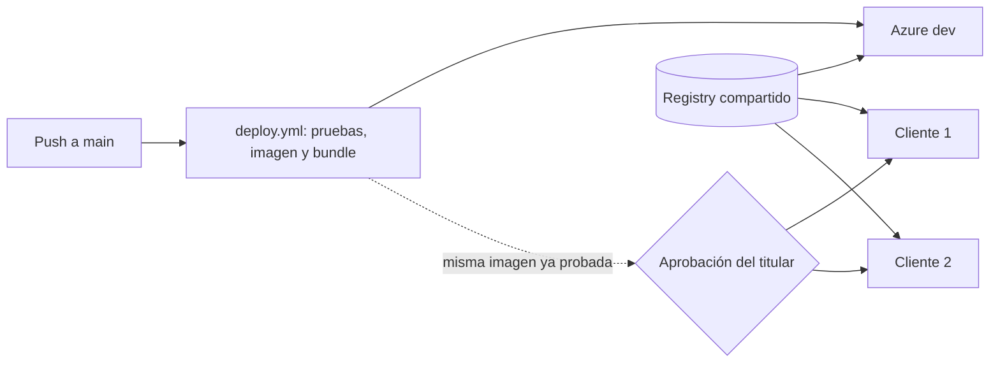

# Producción por cliente: una instalación por empresa

Estado: **propuesta del 2026-11-27, sin programar.** El titular ya tiene clientes y decidió que, mientras el multitenant
no esté terminado, cada empresa que lo contrata tenga su propia instalación en Azure. Cuando el multitenant esté listo, los
clientes pasan a él con un plan aparte. [Azure dev](../deploy/azure-dev.md) sigue siendo el ambiente para probar y romper,
con el número de prueba de WhatsApp.

## Cómo queda

Cada cliente es una instalación completa y aislada, igual a la de dev: su grupo de recursos, su entorno de Container Apps
con la Api y Redis, su PostgreSQL, su Storage, sus anillos de claves con `InstallationId` propio, su origen público y su
número de WhatsApp. No comparten base, caché, archivos ni claves. Borrar el grupo de un cliente lo da de baja entero.

## Decisiones

Lo que el plan fija, con la opción más simple que cumple las reglas del proyecto:

| # | Decisión | Por qué |
|---|---|---|
| PR1 | Un grupo `rg-arquitecturabase-<cliente>` por empresa, con su entorno, su Api, su Redis, su PostgreSQL B1ms y su Storage. `<cliente>` es un nombre corto en minúsculas | Aislamiento completo; el costo y la baja quedan por cliente |
| PR2 | Un solo registry, el de dev, para todos | Es la misma imagen; cada instalación la lee con su identidad (AcrPull sobre ese registry) |
| PR3 | Producción recibe **la imagen y el bundle que ya pasaron por dev**, sin volver a compilar | Lo que se publica en un cliente es exactamente lo que se probó |
| PR4 | Promoción manual: `deploy-production.yml` se corre a mano, eligiendo el cliente y la corrida verde de dev, y espera la aprobación del titular en el environment `prod-<cliente>` | Un push publica sólo en dev; un cliente cambia cuando el titular decide |
| PR5 | El paquete de dev se guarda 30 días, no 3 | Para poder promover una versión probada unos días antes |
| PR6 | Un subdominio por cliente (`<cliente>.<dominio-del-titular>`) con certificado administrado de Container Apps, gratis. Hasta tener el dominio, el FQDN de Azure | Una sola compra de dominio; el cliente puede apuntar después su propio dominio |
| PR7 | Una réplica por instalación | La limpieza de archivos todavía no tiene lease para varias réplicas (N28) |
| PR8 | Respaldos de PostgreSQL de 14 días en producción (7 en dev) | Más margen para restaurar un error de un cliente |
| PR9 | Una alerta de presupuesto y una de errores 5xx por grupo, al correo del titular | Una alerta avisa, no corta el consumo; cada cliente se ve por separado |

**Pendiente del titular (no se programa sin su respuesta):**
- **PR10. De quién es la cuenta de WhatsApp de cada cliente.** Lo más rápido para los primeros es que el número del cliente
  quede en el portfolio del titular: misma app de Meta y un webhook propio por número hacia su instalación, como el de
  prueba hacia la PC. La alternativa, para cuando sean más, es registrarse como proveedor de tecnología (Embedded Signup):
  cada empresa conecta su propia cuenta, con su verificación y su medio de pago.
- **PR11. Con qué cuenta salen los correos.** La de Gmail del titular tiene un cupo de unos 500 por día para todas las
  instalaciones que la usen. La alternativa es una cuenta por cliente o un proveedor transaccional.

## Tareas

| # | Qué | Dónde |
|---|---|---|
| T1 | El script acepta `ACR_RESOURCE_GROUP` (registry compartido), `CUSTOM_DOMAIN` (origen público y certificado), `GITHUB_ENVIRONMENT` (`dev` por defecto; `prod-<cliente>` con el titular como revisor obligatorio), los días de respaldo, y crea las dos alertas | `docs/deploy/provision-azure-dev.sh` (pasa a `provision-azure.sh`) |
| T2 | El job que publica pasa a un workflow reutilizable (`workflow_call`), con el environment y la corrida del paquete como entradas. `deploy.yml` lo llama para dev; `deploy-production.yml` (`workflow_dispatch`) lo llama para un cliente con el paquete de una corrida verde de dev | `.github/workflows/` |
| T3 | El paquete de dev se guarda 30 días | `deploy.yml` |
| T4 | Guía de alta, actualización y baja de un cliente, con los registros DNS, el número de WhatsApp y la primera promoción | `docs/deploy/produccion-por-cliente.md`, y las referencias en `azure-dev.md`, `azure-setup.md` y el `AGENTS.md` de workflows |
| T5 | El primer cliente: script, DNS, WhatsApp, promoción, `/health` e ingreso del administrador | Azure y GitHub |

T1 a T4 se programan juntas: sin T2 no hay cómo publicar en un cliente, y sin T1 no hay cliente. T5 va cuando el titular
tenga los datos del primero.

## Lo que hace el titular por cada cliente

1. El nombre corto, el subdominio y los dos registros DNS (CNAME y el TXT `asuid`) en el proveedor del dominio.
2. El correo del administrador del cliente, que va en `SEED_ADMIN_EMAIL`.
3. El número de WhatsApp: registrarlo con el código que llega por SMS o llamada, el nombre visible, las plantillas
   aprobadas y el medio de pago (según PR10).
4. Aprobar el gasto (unos USD 35 a 60 por mes por cliente, más los mensajes de WhatsApp) y cada promoción en GitHub.

## Fuera de este plan

- Pasar los clientes al multitenant, con sus datos: plan aparte cuando el multitenant esté listo.
- Compartir un servidor de PostgreSQL entre clientes para bajar el costo: se decide si el costo lo pide.
- Red privada para la base y Key Vault: siguen en [verificación y producción](verificacion-y-produccion.md#despliegue-y-operación).
