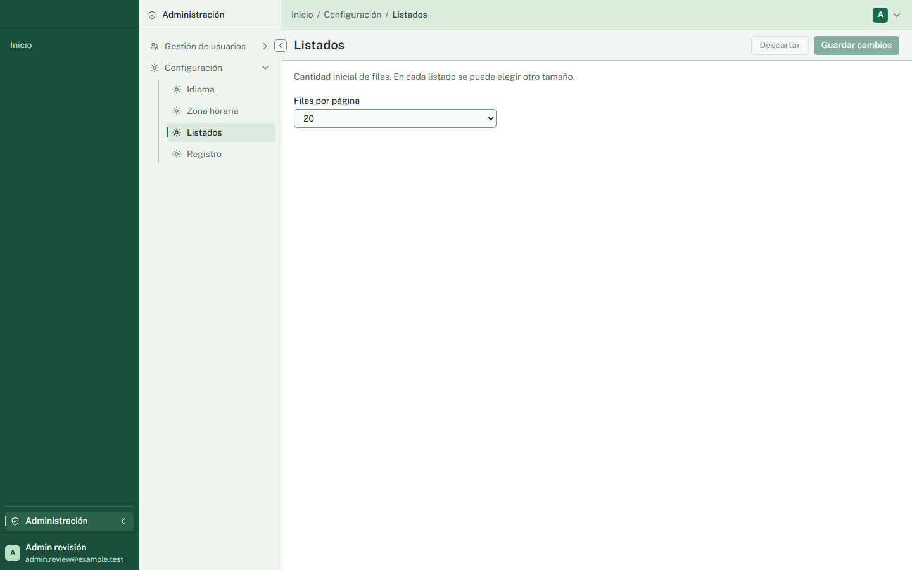
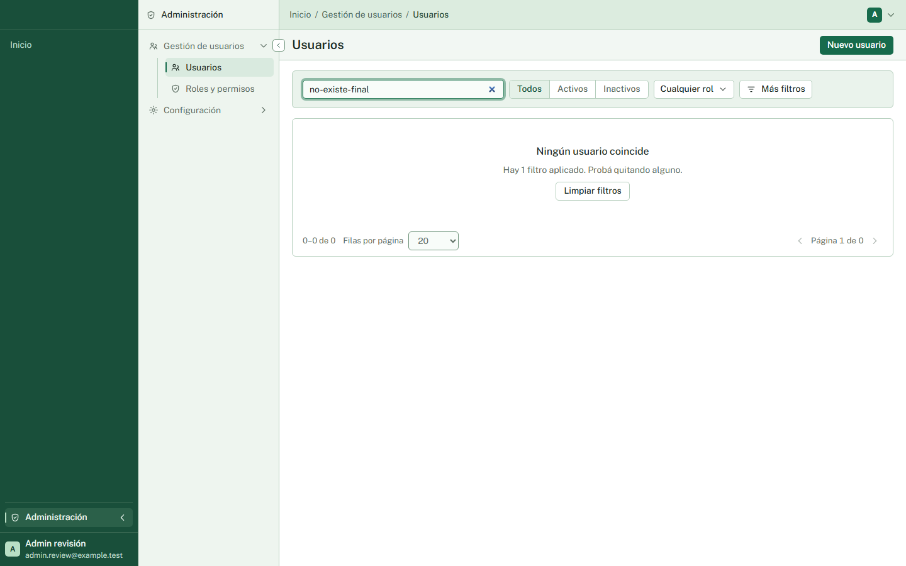

# Revisión funcional y de código — 2026-10-01

La revisión inicial encontró **dos defectos reproducibles en el front**. Ambos tienen correcciones implementadas en la actualización al final de este informe. Los recorridos principales de acceso, perfil, usuarios, roles, permisos y configuración funcionaron contra la API real. Las integraciones externas requieren todavía una comprobación con sus proveedores reales.

## Hallazgos

### P2 — Configuración muestra datos anteriores después de volver desde Inicio

Ubicación: `../ArquitecturaBaseFront/src/features/settings/pages/SettingsPage.tsx:33`, inicializadores de estado en las líneas 42–43.

Reproducción:

1. Entrar como administrador a **Configuración → Listados**, con 20 filas por página.
2. Ir a Inicio mediante el menú del SPA.
3. Desde otra petición autenticada, guardar 50 filas mediante `PATCH /api/settings`, con la revisión vigente.
4. Volver a Listados mediante el menú.
5. La consulta nueva devuelve HTTP 200 y `defaultPageSize: 50`, pero el selector sigue mostrando 20.

`SettingsPage` monta el editor inmediatamente con la respuesta anterior de la caché. La consulta se actualiza, pero `SettingsEditor` toma `initial` una sola vez para `baseline` y `draft`; la nueva respuesta no actualiza esos estados. También conserva una revisión anterior. El control de concurrencia impide una sobrescritura silenciosa, pero la persona ve una configuración desactualizada y puede recibir un conflicto innecesario al guardar.

Recomendación: inicializar el editor con la lectura actual de ese ingreso a la pantalla, preservando los borradores que la persona ya haya empezado a editar. Agregar una regresión que caliente la caché, salga por navegación SPA, cambie el servidor y vuelva.

Evidencia: [resultado consolidado](2026-10-01/resultados.json), escenario «Settings: al volver por SPA muestra el valor actualizado por otro admin»; [captura](2026-10-01/settings-stale.png). El fallo comprueba que la respuesta nueva trae 50 antes de comparar el selector.

### P3 — Un listado sin resultados muestra «Página 1 de 0»

Ubicación: `../ArquitecturaBaseFront/src/shared/ui/Pagination.tsx:40`.

Reproducción: en Usuarios, buscar un texto que no coincide con ninguna cuenta. El estado vacío y las flechas deshabilitadas son correctos, pero el contador muestra «Página 1 de 0». El componente presenta directamente `page: 1` y `totalPages: 0` de la respuesta.

Recomendación: definir una presentación coherente para cero resultados, por ejemplo omitir el contador de páginas. Mantener el rango 0–0 de 0 y las acciones deshabilitadas.

Evidencia: escenario «Paginado vacío no muestra una página mayor al total» y [captura](2026-10-01/empty-pagination.png).

## Comprobaciones automáticas

| Comprobación | Resultado |
| --- | --- |
| `dotnet build ArquitecturaBase.slnx` | Correcto, 0 advertencias y 0 errores |
| `dotnet test --no-build` | 2015 pruebas correctas, sin fallos ni omitidas; incluye integración con PostgreSQL y Redis reales mediante Testcontainers |
| Front: `npm run build` | Correcto |
| Front: `npm run lint` | Correcto; también pasaron las 24 comprobaciones de arquitectura del script |
| Front: `npm run test` | 730 pruebas correctas en 71 archivos |
| Front: `npm run test:visual` | 20 pruebas Playwright correctas |
| Revisión adicional con Playwright y API real | 57 comprobaciones consolidadas: 55 correctas y los 2 hallazgos anteriores |

Las 57 comprobaciones incluyen ingresos de preparación y restauraciones del entorno; no equivalen a 57 funcionalidades distintas. Los primeros intentos con selectores incorrectos, una navegación de documento completo y un payload inválido se corrigieron y se repitieron. El consolidado conserva el resultado comprobado después de esos reintentos. No se detectaron errores de JavaScript ni respuestas HTTP 5xx en estos recorridos.

## Cobertura funcional contra la aplicación real

| Área | Recorridos comprobados |
| --- | --- |
| Acceso y registro por correo | Código correcto e incorrecto, ingreso de administrador y usuarios, registro abierto/cerrado, correo desconocido sin registro implícito, cuenta ya registrada, confirmación del correo, sesión al recargar y cierre de sesión |
| Sesión y autorización | Cookie y flujo OIDC/PKCE, ausencia de tokens persistidos en localStorage/sessionStorage, 401 sin sesión, 403 sin permiso, bloqueo de rutas del SPA, revocación y restitución de permisos sobre un token ya emitido, desactivación con invalidación de sesión |
| Perfil | Guardar nombre, idioma y zona horaria; persistencia al recargar, ida y vuelta español/inglés |
| Usuarios | Alta, edición, duplicado, invitación y reenvío por correo local, cooldown, búsqueda, vacío, filtros por rol/estado/fecha, chips y limpieza, orden y tamaño en URL, activación/desactivación, borrado lógico y restauración por el mismo correo |
| Roles y permisos | Alta, validaciones, duplicado conservando borrador, búsqueda y selección por área, filtro de elegidos, estado sin coincidencias, edición, guarda al cancelar o volver, Admin protegido, nombre User inmutable, rol inexistente, borrado asignado rechazado y borrado sin usuarios |
| Guardas administrativas | Protección de cuenta propia y rechazo a un operador que intenta desactivar al último Admin |
| Configuración | Los cuatro temas, guardar tamaño/idioma/zona/registro, precedencia de URL y perfil, presentación pública, concurrencia con revisión/comparación/conservación del borrador; se encontró el defecto de caché al volver |
| Borde HTTP y recuperación | 401, 404, 405, JSON ilegible, orden inválido, fecha sin offset, enlace inválido y pantalla inexistente |
| Móvil y teclado | Usuarios, perfil y configuración a 320 px sin desbordamiento global; diálogo real de alta dentro del viewport, Escape y retorno del foco; pruebas visuales adicionales de escritorio y móvil |

Capturas adicionales: [usuarios](2026-10-01/users-final.png), [cuenta con permiso solo de lectura](2026-10-01/reader-permissions.png), [comparación ante conflicto](2026-10-01/settings-conflict.png), [perfil móvil](2026-10-01/real-mobile-perfil.png), [diálogo móvil](2026-10-01/real-mobile-user-dialog.png).

## Límites y pendientes de esta revisión

- **Google real:** no se completó el recorrido contra una cuenta de Google ni su consentimiento externo. La suite automática pasó; eso no prueba la configuración de un proveedor desplegado.
- **SMTP/Gmail real:** los códigos e invitaciones se generaron y verificaron usando `PickupDirectory`. No se comprobó entrega a una casilla real, spam o copias en Enviados.
- **WhatsApp/Meta real:** no se ejecutaron desde el navegador códigos, enlace válido del bot, recepción de webhook real, vinculación/desvinculación ni invitaciones con una cuenta de Meta configurada. Las pruebas del módulo incluidas en la suite pasaron; sus dobles no verifican la entrega externa. Agregar correo a una cuenta que entra solo por WhatsApp queda también fuera de la cobertura real del navegador.
- No se hizo una prueba de carga, de penetración ni un despliegue en Production. Los resultados no garantizan ausencia de otros defectos.

## Entorno y artefactos

Se revisó el estado de trabajo existente de ambos repositorios, incluyendo sus cambios sin commit: backend sobre `6ed49ba`, front sobre `976a973`. En la primera etapa se registraron hallazgos sin corregir código de producción. No se crearon ramas, commits o pushes.

La API compilada sirvió el SPA compilado desde `https://localhost:5280`, con PostgreSQL 18.3 y Redis 8.6 aislados. Se crearon únicamente cuentas ficticias `@example.test`. Los correos se escribieron en una carpeta temporal local y no se enviaron a terceros. Los scripts utilizaron el certificado público de desarrollo para validar TLS.

Los resultados y capturas quedan en esta carpeta. Los scripts exploratorios permanecen en `../ArquitecturaBaseFront/test-results/review/` (ignorado por Git): `review.mjs`, `extra.mjs`, `navigation.mjs`, `final-checks.mjs` e `invitation.mjs`. Dependen de las cuentas y del entorno aislado preparado para esta ejecución; no son todavía una suite repetible desde cero.

Al terminar se detuvo la API aislada y se eliminaron sus dos contenedores y su carpeta temporal. La instancia de Aspire que estaba funcionando antes de la revisión se conservó.

## Correcciones posteriores — P2 y P3

El usuario pidió corregir ambos hallazgos después de recibir la revisión. Mientras se trabajaba, otro chat unificó Configuración; la corrección del P2 y sus regresiones se verificaron sobre esa pantalla nueva.

- **P2:** el editor se inicializa una sola vez, durante el render, después de una lectura exitosa del montaje actual. Los datos anteriores de la caché no habilitan la edición. Un fallo antes de abrir el editor ofrece Reintentar; las consultas posteriores conservan el borrador y su revisión, incluso si fallan.
- **P3:** `Pagination` omite el contador de páginas cuando no hay resultados. Conserva el rango 0–0 de 0 y los controles de navegación correspondientes al resultado vacío.

Se agregaron primero las regresiones y se observaron en rojo. Luego pasaron las cinco pruebas nuevas de Vitest: caché al volver y uso de la revisión nueva, fallo de carga con caché y recuperación, conservación del borrador durante un refetch exitoso o fallido, y paginado vacío. Playwright agregó otras cinco: vuelta a Configuración después de un cambio externo y paginado vacío en español/inglés a 1440/320 px. Estas últimas usan los componentes, rutas y providers reales con el servidor simulado del catálogo; no representan una nueva ejecución contra proveedores externos.

Evidencia después de corregir: [Configuración con el valor actualizado](2026-10-01/settings-fresh-fixed.png) y [listado vacío a 320 px](2026-10-01/empty-pagination-fixed-320.png). Las capturas y el JSON de la primera etapa se conservan como evidencia histórica del fallo.

Verificación final sobre el estado compartido de ambos repositorios: build del backend sin advertencias ni errores, 2034 pruebas del backend correctas (incluida integración con PostgreSQL y Redis reales), build y lint del front correctos, 770 pruebas del front y 39 pruebas Playwright correctas. Las cinco regresiones de navegador del P2/P3 están incluidas en esas 39. Para evitar recargas causadas por las ediciones simultáneas de otros chats, esta ejecución de Playwright usó un servidor de pruebas en el puerto 61937 con HMR desactivado mediante una configuración temporal; no se cambió la configuración de desarrollo del producto. El servidor de pruebas se apagó al finalizar.
